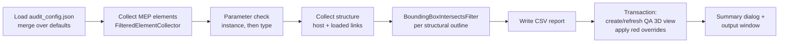

# MEP_IFCSG_Auditor

**One-click QA/QC for MEP models before Singapore CORENET X / IFC-SG submissions, built as a pyRevit extension for Autodesk Revit.**


The tool checks every duct, pipe, piece of mechanical equipment and cable tray in a model. It flags missing IFC-SG data and likely clashes with structure, colours each problem element red in a dedicated 3D view and writes a timestamped CSV audit report. A job that usually takes an afternoon of schedule filtering becomes a repeatable check that a modeller can run before every model exchange.

> **IFC-SG vs IFC+SG:** Singapore's agencies use the spelling *IFC-SG*. You will also see it written as *IFC+SG*. Both refer to the same thing: IFC files carrying the Singapore-specific property sets required for CORENET X.

---

## Why this matters for Singapore projects

CORENET X is Singapore's single platform for building-plan regulatory submissions. It replaces separate submissions to each agency with coordinated "gateway" submissions of IFC-SG BIM models. Adoption is now mandatory:

| Date | Who must submit through CORENET X |
|---|---|
| 1 Oct 2025 | New projects with GFA ≥ 30,000 m² |
| 1 Oct 2026 | New projects with GFA ≥ 5,000 m² |

*Source: URA circulars [DC25-07](https://www.ura.gov.sg/guidelines/circulars/dc25-07/) and [DC26-08](https://www.ura.gov.sg/guidelines/circulars/dc26-08/). Check the latest circulars for current thresholds.*

As a result, missing or placeholder data in the model is now a submission risk, not just a tidiness problem. An MEP model can hold thousands of elements, and every element needs the right classification, identifiers and fire data before export. Checking that by hand is slow, easy to get wrong, and usually happens at the last minute.

## What it does

| # | Step | How |
|---|---|---|
| 1 | **Collects MEP elements** | `FilteredElementCollector` over Ducts (`OST_DuctCurves`), Pipes (`OST_PipeCurves`), Mechanical Equipment (`OST_MechanicalEquipment`) and Cable Trays (`OST_CableTray`). Categories are configurable. |
| 2 | **Checks IFC-SG parameters** | Flags each required parameter that is missing, empty, whitespace-only or still a placeholder (`TBC`, `TBA`, `TBD`). The default checklist covers `System Classification`, `Comments`, `Mark`, `SG_Asset_Code` and `Fire_Rating`, and the checklist is configurable per category. |
| 3 | **Runs a structural clash pre-check** | Tests ducts and pipes against Structural Framing and Structural Columns, in the host model **and in loaded Revit links**, using `BoundingBoxIntersectsFilter`. Link transforms (including rotation) are applied. |
| 4 | **Builds a visual QA view** | Creates or refreshes the 3D view `QA_MEP_Compliance_Check`, colours each failed element solid red and halftones passing elements. |
| 5 | **Writes an audit report** | Saves `IFCSG_MEP_Audit_<Model>_<YYYYMMDD_HHMMSS>.csv` to the Desktop. Also shows a summary dialog and a clickable results list in the pyRevit output window. |

## Business value

**For a Singapore MEP consultant or contractor, the tool:**

- **Cuts the time spent on QA.** Parameter checks, isolating failures, a structural sweep and compiling an issue list become one button press plus review time.
- **Lowers the risk of resubmission.** Gaps in IFC-SG data are caught inside Revit, before IFC export and before the model reaches the agencies.
- **Catches clashes earlier.** Obvious duct/pipe-through-beam problems surface on the modeller's desk instead of at the weekly federated clash meeting.
- **Leaves an audit trail.** Every run writes a timestamped CSV that can go into BIM Execution Plan QA records, and comparing runs over time shows progress.
- **Adapts without code changes.** BIM managers edit a JSON checklist (Shift+Click the button) to match each project's IFC-SG mapping.

### Illustrative time comparison

*These numbers are assumptions for an example model with about 6,000 MEP elements over 10 levels. They are not measurements, so replace them with timings from your own projects.*

| QA task (per check cycle) | Manual | With MEP_IFCSG_Auditor |
|---|---|---|
| Build or filter schedules and scan 5 parameters × 4 categories | 2–3 h | Automatic |
| Isolate and colour failing elements for the modelling team | 30–60 min | Automatic |
| Visual sweep for MEP through beams and columns | 1–2 h | Automatic pre-check |
| Compile an issue list for the team | 30 min | CSV generated |
| **Total** | **≈ 4–6.5 h** | **A few minutes of run time, plus review** |

Over a pre-submission period with two QA cycles a week, that is roughly **a working day saved per week, per model** under these assumptions.

## Installation

**Requirements:** Autodesk Revit with [pyRevit](https://github.com/pyrevitlabs/pyRevit) installed (4.8 or newer; 5.x recommended).

1. Clone the repository:
   ```bash
   git clone https://github.com/Kuru-6g/automation.git C:\BIM\automation
   ```
2. Register the folder that contains `MEP_Tools.extension` with pyRevit, using either method:
   - **pyRevit CLI:**
     ```bash
     pyrevit extensions paths add C:\BIM\automation
     ```
   - **pyRevit UI:** pyRevit tab → *Settings* → *Custom Extension Directories* → add `C:\BIM\automation` → *Save Settings and Reload*.
3. An **Audit** tab appears in Revit with the **QA_QC** panel and the **IFC-SG Audit** button.

## Usage

1. Open the MEP project model. Load the structural model as a Revit link if you want the clash pre-check to include it.
2. Click **Audit → QA_QC → IFC-SG Audit**.
3. Wait for the progress bars. You can cancel at any point before the model is changed.
4. In the summary dialog, choose **Open QA 3D view** to jump to the red-highlighted elements, or **Open CSV report**.
5. In the pyRevit output window, click any element ID to select it in Revit, or click *Select all failed elements*.

**Shift+Click** the button to open the checklist file `audit_config.json`.

## Configuration

All settings live in [`audit_config.json`](MEP_Tools.extension/Audit.tab/QA_QC.panel/IFCSG_Audit.pushbutton/audit_config.json). Any key you delete falls back to the built-in default.

| Key | Default | Purpose |
|---|---|---|
| `audit_categories` | Ducts, Pipes, Mech. Equipment, Cable Trays | Maps report labels to `BuiltInCategory` names. Add fittings, terminals and other categories here. |
| `required_parameters` | `"*"`: Mark, Comments, SG_Asset_Code, Fire_Rating; plus System Classification for ducts, pipes and equipment | `"*"` applies to all categories; other keys add per-category requirements. |
| `check_type_parameters` | `true` | Accepts a value stored on the element's type (common for `Fire_Rating`). |
| `flag_parameters_not_found` | `true` | Reports parameters that are not bound to the category as `[not found]`. |
| `placeholder_values` | `TBC, TBA, TBD` | Values treated as missing (case-insensitive). |
| `clash_check.mep_categories` | Ducts, Pipes | MEP categories tested against structure. |
| `clash_check.structural_categories` | Framing, Columns | Structural categories to test against. |
| `clash_check.include_linked_models` | `true` | Also tests structure in loaded Revit links. |
| `clash_check.bbox_inset_mm` | `5` | Shrinks structural boxes so MEP that only touches structure is not flagged. |
| `qa_view.name` | `QA_MEP_Compliance_Check` | Name of the QA 3D view. |
| `qa_view.fail_color_rgb` | `[255, 0, 0]` | Override colour for failed elements. |
| `qa_view.halftone_passing_elements` / `passing_transparency` | `true` / `0` | De-emphasises passing elements. |
| `report.output_folder` | Desktop | Report folder. Supports `%ENV%` variables and creates the folder if missing. |
| `report.failures_only` | `false` | Writes only failed elements to the CSV. |

## Output

**CSV columns:** `Element ID`, `Category`, `Family & Type`, `Level`, `Missing Parameters`, `Potential Structural Clash (Yes/No)`, `Clashing Structural Elements`, `Audit Status`

The rows below are illustrative only:

| Element ID | Category | Family & Type | Level | Missing Parameters | Potential Structural Clash (Yes/No) | Clashing Structural Elements | Audit Status |
|---|---|---|---|---|---|---|---|
| 1452231 | Ducts | Rectangular Duct: Mitered Elbows / Taps | L03 | SG_Asset_Code; Fire_Rating [placeholder] | Yes | Link: STR_Tower / Structural Framing / Id 889120 | FAIL |
| 1460877 | Pipes | Pipe Types: Copper | L03 | Mark | No | | FAIL |
| 1471002 | Mechanical Equipment | AHU_Horizontal: AHU-03 | L05 | | No | | PASS |

The `Missing Parameters` column uses three formats:

- `Name`: the parameter exists but is empty or whitespace.
- `Name [placeholder]`: the value is `TBC`, `TBA` or `TBD`.
- `Name [not found]`: the parameter is not bound to that category (add the shared parameter to the project).

The file is UTF-8 with a BOM, so Excel shows non-ASCII family names correctly. Failed rows are sorted first.

## How it works



Engineering details:

- **Language-independent checks.** `Mark`, `Comments` and `System Classification` are resolved through `BuiltInParameter` IDs, so the checks also work in non-English Revit. Custom shared parameters are matched by name with `GetParameters()`, which handles duplicate project and shared parameters that have the same name.
- **Correct linked geometry.** All eight corners of each linked element's bounding box are transformed by the link's total transform before the host-space `Outline` is built, so rotated links (for example, true north versus project north) are handled.
- **Native-speed filtering.** Each structural outline runs a `BoundingBoxIntersectsFilter` over the audited MEP IDs inside Revit, which avoids an N × M loop in Python.
- **Safe model changes.** All view work happens in a single `Transaction` that rolls back on any error. The CSV is written *before* the transaction, so a report is saved even if the view update fails.
- **Worksharing aware.** If a colleague has borrowed the shared QA view, the tool updates a personal copy (`QA_MEP_Compliance_Check_<user>`) instead of failing.
- **Repeatable runs.** Elements that were red last time and are now fixed get their overrides reset.
- **Cross-version API handling.** The code uses `ElementId.Value` or `IntegerValue` as available, falls back from Revit 2019+ surface pattern overrides to the older projection-fill API, uses `UseShellExecute` for .NET 8 in Revit 2025+, and finds the Desktop correctly when it is redirected to OneDrive.
- **Runs on both pyRevit engines.** It works on IronPython 2.7 and CPython 3. If `pyrevit.forms` is unavailable, dialogs and progress bars fall back to Revit's `TaskDialog`.

## Limitations

- **This is a pre-check, not full clash detection.** Bounding boxes are axis-aligned, so long diagonal or sloped elements can produce false positives. Use the results to triage, then confirm in Navisworks or Revit Interference Check.
- **Only the active model is audited.** MEP elements in linked models are not checked; open those models and run the tool there.
- **Values are checked for presence, not validity.** The tool does not yet check values against IFC-SG enumerations or units (see the roadmap).
- **Shared parameter names must match exactly.** They are matched by name, so they must match your project's IFC-SG mapping.

## Roadmap

- [ ] Read required parameters directly from the IFC-SG Industry Mapping spreadsheet
- [ ] Validate values against allowed IFC-SG enumerations
- [ ] Confirm bounding-box hits with solid geometry (`ElementIntersectsSolidFilter`)
- [ ] Export issues to BCF for Navisworks, ACC or BIMcollab
- [ ] Add a Power BI or Excel dashboard to track compliance across runs

## Repository structure

```
MEP_Tools.extension/
└── Audit.tab/
    └── QA_QC.panel/
        └── IFCSG_Audit.pushbutton/
            ├── bundle.yaml          # button title, tooltip, author, help link
            ├── script.py            # the audit tool
            ├── config.py            # Shift+Click: opens audit_config.json
            ├── audit_config.json    # editable IFC-SG checklist and settings
            └── icon.png             # 96 × 96 ribbon icon
```

## Author

**Kuru-6g**: BIM automation for MEP, focused on Revit API and pyRevit tools for Singapore projects.
Feedback and issues are welcome via [GitHub Issues](https://github.com/Kuru-6g/automation/issues).
